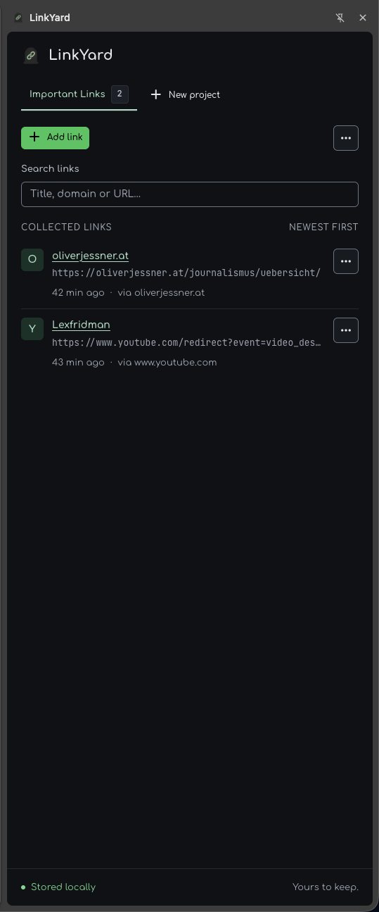
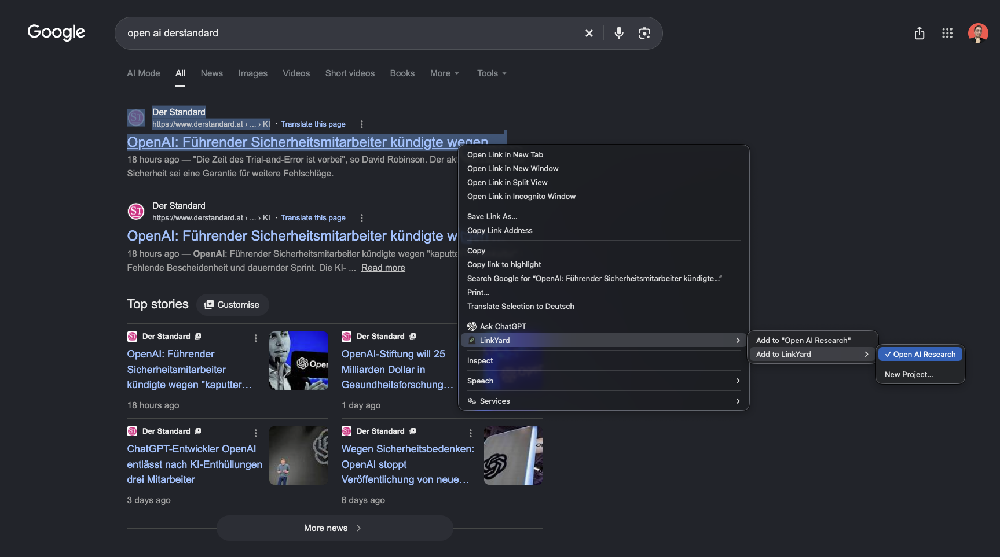

  

# LinkYard 🔗

LinkYard is a Chrome extension that organizes saved links into projects.
It keeps research sources together and easy to find while you browse.
Your collections stay on your device, without an account or tracking.

Create a project for a story, topic or reading list, then save useful links from Chrome's right-click menu. Open the side panel to review your collection alongside the page you are reading. When you need the links elsewhere, export the project as JSON or a plain TXT list.

## What it does

- Save links to an existing or new project from the right-click menu.
- Add links manually or collect external links from the current page.
- Switch between projects and search by title, URL, domain or source.
- Skip duplicate links within each project.
- Rename, move, copy or delete links, and open a project's links in new tabs.
- Import TXT link lists and export projects as JSON or TXT.
- Keep collections locally across browser sessions.

## Install

### Chrome Web Store

Install [LinkYard from the Chrome Web Store](https://chromewebstore.google.com/detail/linkyard/gjiooiibelbfndjihhkppkflbflopnpp) in desktop Chrome 116 or later on Windows, macOS or Linux. Pin LinkYard in Chrome's extensions menu, then click its toolbar icon to open the side panel and create your first project.

The store currently offers version 0.2.3. TXT import and **Collect external links**, described below, are included in this repository's version 0.2.5.

## Save links while you browse

Right-click a link to save it to your current project, choose another project under **Add to LinkYard**, or select **New Project…** to start a collection with that link. You can also paste a URL into **Add link** in the side panel.

## Find and organize your research

Project tabs show link counts and keep separate topics within reach, with the newest links listed first. Search the selected project, give links recognizable names, move them between projects, or choose **Open all links** from the project menu to revisit the whole collection.

## Collect external links from a page

In version 0.2.5, click **Collect external links** to save links pointing to other websites from the current page into the selected project, keeping link text and source information where available. Duplicates are skipped; collection requires page access and is unavailable on Chrome settings, the Web Store and other protected pages.

## Import and export link lists

In version 0.2.5, choose **Import TXT…** from the project menu to add a UTF-8 file containing one complete HTTP or HTTPS URL per line; files can contain up to 10,000 links and be up to 1 MB, with duplicates and invalid lines skipped. Export a project as JSON to retain link details, or as TXT for a URL-only list you can reuse elsewhere; imports accept TXT files only.

## Keep your collections local

Your projects and links stay in your Chrome profile, with no account, cloud sync, analytics or tracking. Export projects before uninstalling to keep your links, and read the [privacy policy](PRIVACY.md) for details about storage, permissions and deletion.

## Who it is for

- Journalists collecting sources for separate stories.
- Researchers organizing references by topic or project.
- Writers and students gathering reading lists.
- Professionals comparing products, services or competitors.

## Changelog

See the [changelog](docs/changelog.md) for release notes and changes.

## License

MIT
